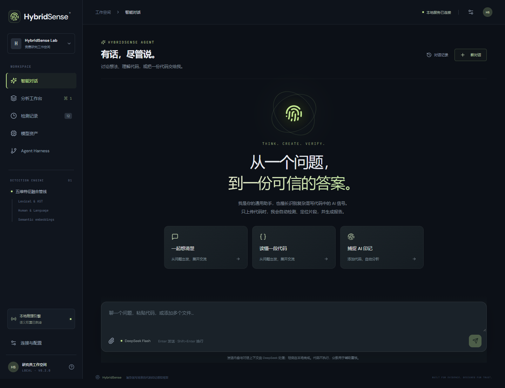
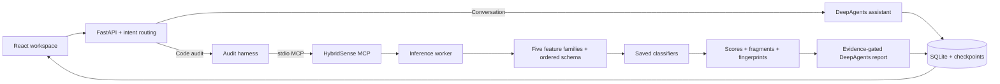

# HybridSense

**Analyze AI signals in mixed human and AI code, with a conversational agent and traceable model evidence.**

[English](README.md) · [简体中文](README.zh-CN.md)

HybridSense combines six language-specific code classifiers, an MCP service, a DeepAgents harness, and a React workspace. Ask a general question, request a code explanation, or submit source files for an audit with ranked fragments and an exportable report.



## Features

- **Intent routing:** ordinary messages receive ordinary answers. Code-only submissions, fenced code blocks, and attachments without instructions trigger detection; explicit explanation or revision requests follow the user's intent.
- **Six languages:** Python, C, C++, Java, JavaScript, and TypeScript, including batches containing different languages.
- **Five feature families:** lexical patterns, syntax, developer habits, language-specific features, and CodeBERTa semantics. The interface shows the features actually retained by each model.
- **Fragment inspection:** function/method boundaries and overlapping token windows, ranked scores, line ranges, exact source previews, and short-context or truncation notices.
- **Agent harness:** plans, bounded model/tool calls, a real MCP connection, evidence checks, SQLite checkpoints, cancellation, retries, and persisted conversation history.
- **Reports:** Markdown, JSON evidence, model/source/schema fingerprints, coverage indicators, and actual ensemble-member scores.

## Interpreting scores

The interface uses **AI-generation score**. Scores are **uncalibrated**, not verified authorship probabilities or percentages of AI-written lines.

| Output | Definition |
| --- | --- |
| Overall score | The original file-level classifier's output for the AI class |
| Fragment score | The classifier applied to a function or context window; exploratory localization |
| Local summary | Window scores averaged per covered non-whitespace character, correcting overlap |
| Multi-file summary | File scores weighted by non-whitespace character count; cross-language scores are not jointly calibrated |
| High-signal marker | An engineering review threshold of 0.80; 0.65 marks additional review candidates |

Thresholds have not been selected on a new independent validation set. Highlighted lines inherit fragment context; they are not line-level authorship labels. Formal accuracy, calibration, and robustness claims require separate labeled evaluation. See [research methodology](RESEARCH.md) and [engineering validation](VALIDATION.md).

## Quick start

The supplied scripts target **Windows**. Install Python 3.12, [uv](https://docs.astral.sh/uv/), Node.js 20+, and Git. First setup requires internet access.

```powershell
git clone https://github.com/aiorx/HybridSense.git
cd HybridSense
powershell -ExecutionPolicy Bypass -File .\setup.ps1
```

Setup installs the locked dependencies, downloads CodeBERTa into `runtime/models/codeberta/`, builds the frontend, and creates `.env` from `.env.example` if needed. The six task-specific classifiers and ordered feature schemas are included in `models/`.

Configure the optional model connection in `.env`:

```dotenv
DEEPSEEK_API_KEY=your_api_key
DEEPSEEK_BASE_URL=https://api.deepseek.com
DEEPSEEK_MODEL=deepseek-flash
HYBRIDSENSE_MODEL_ROOT=models
HYBRIDSENSE_EMBEDDING_PATH=runtime/models/codeberta
```

Start the application and open **http://127.0.0.1:8000**:

```powershell
.\start.cmd
```

Use `start.cmd 8002` or `./start.ps1 -Port 8002` for another port. Stop a foreground server with `Ctrl+C`.

General conversation and agent-written interpretations require a valid API key. Without one, the analysis workbench still supports local detection and a deterministic evidence report. Source code is parsed and classified, never executed. Conversation content, selected source fragments, and report evidence can be sent to the configured model provider; the key stays on the backend.

### Workflows

1. **Chat:** send a question in the conversational workspace.
2. **Explain or revise:** attach code and state the requested explanation, review, or change.
3. **Audit by default:** attach files without text, paste standalone code, or send fenced code blocks with language tags.
4. **Review:** expand a file, filter and inspect ranked fragments, then export Markdown or JSON.
5. **Workbench:** choose a language and paste or upload a single file; agent interpretation is optional.

Limits: **10 files/code blocks**, **512 KiB total**, **128 KiB / 3,000 lines per file**. Files must use UTF-8. For ambiguous code, specify a language tag such as `python` or select the attachment language.

## Architecture



The audit stage always uses the real MCP detector. Report tools can read saved evidence, inspect fragments, query detectors, or recheck the immutable current submission. General conversation uses a separate route and can read attachments or previous analysis when needed.

```text
backend/       FastAPI, MCP, classifiers, localization, agent harness, persistence
frontend/      React + TypeScript + Vite interface
models/        Six selected classifiers, original extractors, schemas, hashes
scripts/       Encoder preparation, asset export, integration checks
tests/         Model, protocol, conversation, localization, and asset checks
docs/images/   Workspace preview
runtime/       Local runs, encoder weights, checkpoints; excluded from Git
```

### Inference assets

| Language | Features | Classifier |
| --- | ---: | --- |
| Python | 400 | Voting ensemble |
| C | 400 | Voting ensemble |
| C++ | 400 | Voting ensemble |
| Java | 300 | Voting ensemble |
| JavaScript | 300 | Voting ensemble |
| TypeScript | 300 | LightGBM |

Voting members are LightGBM, Random Forest, and HistGradientBoosting. Historical model file names do not necessarily identify the estimator class.

Only the selected classifiers, required original extractor/config files, ordered JSON schemas, and a checksum manifest are included. Schemas contain column names, **no training rows**. Original `emb-_cbt/` datasets, experiments, ablations, and raw feature tables are excluded. Local original experiments remain supported through `HYBRIDSENSE_MODEL_ROOT=emb-_cbt` and the CSV-header adapter.

CodeBERTa uses a 768-dimensional CLS representation with a 512-token input limit. The download script records its revision and hashes; the original training did not record an encoder revision, so exact historical reconstruction cannot be guaranteed. Localization adds 480-token windows with a 384-token stride, capped at 128 windows and 96 functions/methods per file; incomplete coverage is disclosed.

### Harness boundaries

- Up to 8 model calls and 12 tool calls per agent run.
- Default timeouts: 240 seconds per detector call, 120 seconds per interpretation, 45 seconds per provider request with at most one SDK retry.
- One active task and at most four active/queued jobs.
- Detection evidence is saved before interpretation and can be reused on retry.
- Reports must read actual evidence. Source text is untrusted data; execution tools and general-purpose subagents are disabled.
- Detector subprocesses receive only the required environment, without the API key.

The worker is a process boundary for resource control, not an operating-system security sandbox. The app binds to localhost by default; public multi-user deployment requires additional authentication and isolation.

## MCP and HTTP API

Run the stdio MCP server from the project directory:

```powershell
.venv\Scripts\python.exe -m backend.mcp_server
```

Use [mcp-config.example.json](mcp-config.example.json), replacing **all** `C:\path\to\HybridSense` placeholders. A stdio server normally waits silently for JSON-RPC input. For Streamable HTTP, append `--http`; the endpoint is `http://127.0.0.1:8001/mcp`.

- `list_detectors()` — list six detectors and semantic-weight availability.
- `analyze_code(code, language, localize=True)` — classify and optionally inspect fragments.
- Language IDs: `python`, `c`, `cpp`, `java`, `javascript`, `typescript`.

Interactive REST documentation: **http://127.0.0.1:8000/docs**.

| Endpoint | Purpose |
| --- | --- |
| `GET /api/health` | Availability and connection status; never the API key |
| `POST /api/chat` | `{session_id, message?, sources?, use_agent?}` |
| `GET /api/chat/{session_id}` | Restore the latest 40 conversation turns |
| `POST /api/runs` | Single-file audit: `{code, language, filename?, use_agent?}` |
| `POST /api/upload` | Multipart: `file`, `language`, `use_agent` |
| `GET /api/runs/{id}` | Task, evidence, and report |
| `GET /api/runs/{id}/events?after=0` | Incremental execution events |
| `POST /api/runs/{id}/cancel` / `resume` | Cancel or retry |
| `GET /api/runs/{id}/report` | JSON; add `?format=markdown` to download Markdown |

`session_id` is a 32-character lowercase hexadecimal string; each `sources` entry is `{filename, language?, code}`. Full task/history endpoints intentionally retain local source content. Report exports omit raw source fields, although interpretations can quote selected fragments.

## Development and validation

```powershell
.venv\Scripts\python.exe -m pytest -q
cd frontend
npm run build
```

Prepare CodeBERTa before running model tests. Agent tests use controlled models and do not require a provider key. Tests cover real classifiers and MCP calls, feature alignment, non-execution, evidence checks, intent routing, AST boundaries, coverage, overlap correction, Unicode offsets, and inference-asset integrity.

For frontend development, run `npm run dev` in `frontend/` with the backend on port 8000.

Optional checks:

- `scripts/api_smoke.py`: API cancellation, recovery, and exports.
- `scripts/accept_v2.py`: live DeepSeek conversation, memory, explanation, and multi-file auditing; **uses API credits**.
- `scripts/browser_v2.cjs <node_modules_path>`: Playwright with Microsoft Edge; run live acceptance first to generate its sample report.
- `scripts/package_assets.py`: export inference assets from local original experiments into a new directory; refuses to overwrite an existing destination.

Credentials, dependencies, builds, local histories, checkpoints, downloaded encoder weights, and original training data are excluded from Git.

## Research references

- [Guo et al. — On Calibration of Modern Neural Networks, ICML 2017](https://proceedings.mlr.press/v70/guo17a.html)
- [scikit-learn — Probability calibration](https://scikit-learn.org/stable/modules/calibration.html)
- [Patterson et al. — HybridCodeAuthorship, 2026](https://arxiv.org/abs/2606.12620)
- [CodeDet-NITS — AI Code Authorship Detection Beyond Truncation, SemEval 2026](https://aclanthology.org/2026.semeval-1.397/)
- [Orel et al. — Droid, EMNLP 2025](https://aclanthology.org/2025.emnlp-main.1593/)

These works inform the design and evaluation protocol; their benchmark results are not claimed as HybridSense results. See [RESEARCH.md](RESEARCH.md) for detailed methodology and the proposed independent evaluation.
