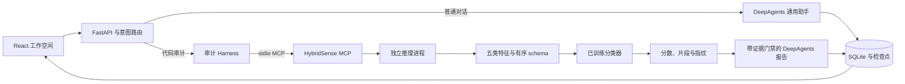

# HybridSense

**面向复杂人机混写场景的 AI 代码印记分析框架：通用对话、片段定位与可追溯模型证据。**

[English](README.md) · [简体中文](README.zh-CN.md)

HybridSense 将六语言代码分类器、MCP 服务、DeepAgents 智能体 Harness 与 React 工作空间集成在一起。可以正常交流、请求解释或修改代码，也可以提交源码，获取整体生成倾向、重点片段和可导出的分析报告。


## 核心功能

- **按意图工作**：普通消息正常交流；只发送附件、纯代码或带语言标签的代码块时默认检测；明确要求解释、修改代码时按其要求处理。
- **六语言覆盖**：Python、C、C++、Java、JavaScript、TypeScript，支持多语言文件混合提交。
- **五类特征融合**：词法、语法、开发者习惯、语言特性、CodeBERTa 语义；界面展示模型真正保留的特征。
- **重点片段定位**：函数 / 方法与重叠 token 窗口扫描，按分数排序，提供行号、精确源码预览、短上下文与截断提示。
- **智能体 Harness**：计划、真实 MCP 调用、模型 / 工具预算、证据门禁、SQLite 检查点、取消 / 重试与多轮上下文。
- **报告导出**：Markdown、JSON、模型 / 源码 / 特征顺序指纹、扫描覆盖率及真实集成成员分数。

## 分数的含义

系统使用 **AI 生成倾向分数**，明确标记 **未校准**，不将其解释为真实作者概率或 AI 代码行占比。

| 输出 | 定义 |
| --- | --- |
| 整体分数 | 原文件级分类器对 AI 类的输出 |
| 片段分数 | 对函数或上下文窗口再次调用原分类器，属于探索性定位 |
| 局部汇总 | 先对覆盖同一非空白字符的窗口分数取均值，再汇总，避免重叠重复计权 |
| 多文件汇总 | 按非空白字符数加权的文件分数；跨语言模型未统一校准 |
| 高信号标识 | 0.80 为工程高信号阈值，0.65 为补充复核阈值 |

阈值尚未通过新的独立验证集确定。源码行色继承片段上下文分数，不是逐行作者标签。正式准确率、校准与鲁棒性结论需要另行开展标注实验。详见 [研究方法](RESEARCH.md) 与 [工程验证](VALIDATION.md)。

## 快速开始

当前安装和启动脚本面向 **Windows**。需要 Python 3.12、[uv](https://docs.astral.sh/uv/)、Node.js 20+ 与 Git。首次安装需要联网。

```powershell
git clone https://github.com/aiorx/HybridSense.git
cd HybridSense
powershell -ExecutionPolicy Bypass -File .\setup.ps1
```

安装脚本会安装锁定依赖，将 CodeBERTa 下载至 `runtime/models/codeberta/`，构建前端，并在不存在 `.env` 时从模板创建配置。六语言任务分类器与有序特征 schema 已包含在 `models/` 中。

如需通用对话或智能体解读，在 `.env` 填写模型连接：

```dotenv
DEEPSEEK_API_KEY=你的API密钥
DEEPSEEK_BASE_URL=https://api.deepseek.com
DEEPSEEK_MODEL=deepseek-flash
HYBRIDSENSE_MODEL_ROOT=models
HYBRIDSENSE_EMBEDDING_PATH=runtime/models/codeberta
```

启动后打开 **http://127.0.0.1:8000**：

```powershell
.\start.cmd
```

修改端口可运行 `start.cmd 8002` 或 `./start.ps1 -Port 8002`；前台运行按 `Ctrl+C` 停止。

通用对话和智能体报告需要有效 API Key。不配置密钥时，仍可在分析工作台进行本地模型检测并生成确定性的证据报告。源码只解析、分类，不执行。对话内容、选中片段与报告证据可能发送至配置的模型提供方；密钥只保留在服务端。

### 使用方式

1. **正常交流**：直接发送问题。
2. **解释或修改**：添加代码，同时说明希望解释、审查或修改什么。
3. **默认审计**：只添加文件后发送，或粘贴纯代码 / 带语言标签的代码块，自动检测并生成报告。
4. **复核证据**：展开文件，筛选、查看重点片段，导出 Markdown 或 JSON。
5. **单文件工作台**：选择语言，粘贴或上传代码，可按需启用智能体解读。

每次最多 **10 个文件 / 代码块**、总计 **512 KiB**；单文件最多 **128 KiB、3000 行**。文件需使用 UTF-8。难以自动识别时，请在代码块开头标注 `python` 等语言，或为附件选择语言。

## 系统架构



审计流程通过真实 MCP 分类。报告工具可读取已保存证据、检查片段、查询模型或复验当前不可变提交。普通对话走独立路由，可按需读取附件或本会话最近的分析。

```text
backend/       FastAPI、MCP、分类器适配、定位、智能体与持久化
frontend/      React + TypeScript + Vite 界面
models/        六套分类器、原始提取器、特征 schema 与校验清单
scripts/       编码器准备、资产导出、集成验收
tests/         模型、协议、对话、定位与资产检查
docs/images/   界面预览
runtime/       本地任务、编码器、检查点，不上传 Git
```

### 推理资产

| 语言 | 特征数 | 决策框架 |
| --- | ---: | --- |
| Python | 400 | 集成投票 |
| C | 400 | 集成投票 |
| C++ | 400 | 集成投票 |
| Java | 300 | 集成投票 |
| JavaScript | 300 | 集成投票 |
| TypeScript | 300 | 集成投票 |

表格统一使用集成投票框架命名。Python、C、C++、Java 和 JavaScript 的投票成员为 LightGBM、随机森林和 HistGradientBoosting；当前 TypeScript 资产仅启用 LightGBM 一个成员。历史文件名不一定对应真实分类器类型。

仓库仅包含选定分类器、必需的原始提取器 / 配置、有序 JSON 特征 schema 与哈希清单。schema **只保存列名，不包含训练数据行**。原始 `emb-_cbt/` 数据集、实验、消融结果与完整特征表不上传。已有原实验的本地环境仍可设置 `HYBRIDSENSE_MODEL_ROOT=emb-_cbt`，继续通过 CSV 表头适配。

CodeBERTa 沿用 768 维 CLS 表征和 512 token 输入上限。准备脚本记录本次下载 revision 与文件哈希；原训练未记录编码器 revision，无法保证精确还原历史版本。定位另使用 480 token 窗口与 384 token 步长，每文件最多 128 个窗口、96 个函数 / 方法；预算不足时披露实际覆盖率。

### Harness 边界

- 每次 Agent 最多 8 次模型调用、12 次工具调用。
- 默认单次检测 240 秒、智能体解读 120 秒、供应商请求 45 秒，SDK 最多重试一次。
- 一个活动任务，最多四个活动或排队任务。
- 先保存模型证据，再生成报告；重试可复用文件证据。
- 检测报告必须读取真实证据；源码视为不可信数据，不开放执行工具与通用子 Agent。
- 检测子进程只接收必需环境变量，不接收 API Key。

独立进程用于资源控制与可靠终止，并非操作系统级安全沙箱。应用默认绑定本机回环地址；公网、多用户部署需另行增加认证与隔离。

## MCP 与 HTTP API

在项目目录启动 stdio MCP 服务：

```powershell
.venv\Scripts\python.exe -m backend.mcp_server
```

参考 [mcp-config.example.json](mcp-config.example.json)，将其中**所有** `C:\path\to\HybridSense` 替换为实际目录。stdio 服务静默等待 JSON-RPC 输入是正常行为。追加 `--http` 可启动 Streamable HTTP，端点为 `http://127.0.0.1:8001/mcp`。

- `list_detectors()`：六模型与语义权重状态。
- `analyze_code(code, language, localize=True)`：分类和可选片段检查。
- 语言标识：`python`、`c`、`cpp`、`java`、`javascript`、`typescript`。

交互式 REST 文档：**http://127.0.0.1:8000/docs**。

| 端点 | 用途 |
| --- | --- |
| `GET /api/health` | 模型和连接状态，不返回密钥 |
| `POST /api/chat` | `{session_id, message?, sources?, use_agent?}` |
| `GET /api/chat/{session_id}` | 恢复最近 40 个会话回合 |
| `POST /api/runs` | 单文件：`{code, language, filename?, use_agent?}` |
| `POST /api/upload` | multipart：`file`、`language`、`use_agent` |
| `GET /api/runs/{id}` | 任务、证据与报告 |
| `GET /api/runs/{id}/events?after=0` | 增量事件 |
| `POST /api/runs/{id}/cancel` / `resume` | 取消或重试 |
| `GET /api/runs/{id}/report` | JSON，追加 `?format=markdown` 下载 Markdown |

`session_id` 为 32 位小写十六进制字符串；`sources` 元素为 `{filename, language?, code}`。完整任务和会话接口保留本地源码；报告导出移除原始源码字段，但解读正文可能引用选定片段。

## 开发与验证

```powershell
.venv\Scripts\python.exe -m pytest -q
cd frontend
npm run build
```

真实模型测试前需准备 CodeBERTa。Agent 测试使用受控模型，不要求 API Key。测试覆盖真实分类器与 MCP、特征对齐、源码不执行、证据门禁、意图路由、AST 边界、覆盖率、重叠计权、Unicode 偏移和资产完整性。

前端开发可在后端运行于 8000 端口时，在 `frontend/` 执行 `npm run dev`。

可选验收：

- `scripts/api_smoke.py`：API 取消、恢复、导出。
- `scripts/accept_v2.py`：真实 DeepSeek 对话、记忆、解释与多文件检测，**产生 API 用量**。
- `scripts/browser_v2.cjs <node_modules路径>`：Playwright 与 Microsoft Edge；先运行真实 API 验收，生成所需示例报告。
- `scripts/package_assets.py`：从原实验导出新的最小推理资产目录，拒绝覆盖已有目标。

凭据、依赖、构建产物、本地历史、检查点、下载的编码器和原始训练数据均排除在 Git 之外。

## 研究参考

- [Guo 等：On Calibration of Modern Neural Networks，ICML 2017](https://proceedings.mlr.press/v70/guo17a.html)
- [scikit-learn：Probability calibration](https://scikit-learn.org/stable/modules/calibration.html)
- [Patterson 等：HybridCodeAuthorship，2026](https://arxiv.org/abs/2606.12620)
- [CodeDet-NITS：AI Code Authorship Detection Beyond Truncation，SemEval 2026](https://aclanthology.org/2026.semeval-1.397/)
- [Orel 等：Droid，EMNLP 2025](https://aclanthology.org/2025.emnlp-main.1593/)

上述研究用于支持设计与评估方法，其基准成绩不作为本项目成绩。计算细节与后续独立评估方案见 [RESEARCH.md](RESEARCH.md)。
